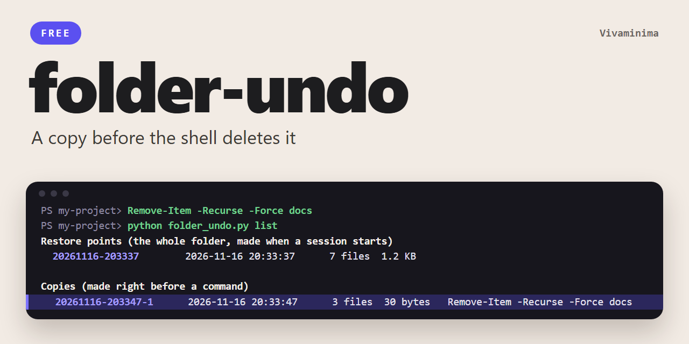

# folder-undo



**You asked AI to tidy a folder. Now the files are gone?**

When Claude deletes files with a command, they skip the Recycle Bin. Claude Code's /rewind can't bring them back either. folder-undo copies each file right before it gets deleted. Lost something? Just say "bring it back."

We tried it ourselves, in a real Claude Code window. We wiped a docs folder with one command and brought every file back. Not one character changed, and the modified times match too.

**This free version is a one-time trial: it restores once on each PC.** To keep restoring, use [Folder Undo Pro](https://vivastory4.gumroad.com/l/folder-undo-pro?utm_source=github-readme).

## Try it free (one restore)

- It copies your files before every delete, every time.
- **It restores once.** Your first restore on each PC is free, and it is a one-time restore.
- After that, your copies stay right in your folder, in `.folder-undo`, and Pro puts them all back in one step.

**Want to keep using it?** Get [Folder Undo Pro](https://vivastory4.gumroad.com/l/folder-undo-pro?utm_source=github-readme). It restores as many times as you need, including the copies this free version already made.

## Install by asking Claude

1. **Download it.** On this page, click the green **Code** button, then **Download ZIP**. Unzip it anywhere.
2. **Say one line to Claude**, from that folder:
   "Install folder-undo in my project folder. Show me the changes first."
3. **Press y once.** Claude shows you the lines it will change, then waits for your y.

It turns on from your next window. Your existing settings stay as they are.

What you need: Python 3.10 or newer on your PC (free version). Pro for Windows comes with Python 3.13 inside, so there is nothing to install.

## Using it is just talking

When files are gone, tell Claude:

"Show me what you can restore, then restore it"

## Folder Undo Pro

Pay once. Using the free version already? One y switches you to Pro.

- Restore as many times as you need, the free version's copies too
- Pick a restore point from your last 10 sessions
- See the past versions of a single file
- A one-page report for each session
- Optional, off by default: stops commands that try to delete outside your folder
- Windows: Python 3.13 included, no install needed

Get it here: [Folder Undo Pro](https://vivastory4.gumroad.com/l/folder-undo-pro?utm_source=github-readme)

## Running a one-person business?

No one else will undo it for you. Client files, quotes, your books: one AI command can wipe them, and the Recycle Bin won't have them. Your first restore is free. To keep restoring after that, use [Folder Undo Pro](https://vivastory4.gumroad.com/l/folder-undo-pro?utm_source=github-readme).

## How it works

Keeps a copy of a file right before a shell command deletes, moves or overwrites it — the part Claude Code's rewind doesn't cover.

Claude Code's checkpoints track the edits made by its file editing tools. Its documentation lists
"Bash command changes not tracked" as a limitation: "A file that only Bash commands changed isn't
tracked and stays as it is." https://code.claude.com/docs/en/checkpointing

folder-undo is one Python file and two hooks:

- **Before a Bash or PowerShell command runs**, the hook reads the command. If it would delete, move or
  overwrite paths inside the project folder, those paths are copied to `.folder-undo/<time>-<n>/` first,
  with a `manifest.json` (command, time, paths, bytes, sha256). It does not block: the command always runs.
- **When a session starts**, the hook keeps one restore point of the whole project folder in
  `.folder-undo/store/`. Files are stored by their sha256, so only changed files are written again.
  When the next session starts, the earlier restore point is replaced.

Reading a command does not catch every form (for example, a file deleted from inside a script).
That is why a restore point of the whole folder is kept when a session starts. Restore points for
several sessions and a report are in Pro.

### What the free edition does

Copies are always made, as often as a command needs one. `list` and `show` are always open.
**`restore` puts files back once on each PC.** Run it on the file that matters most. After that,
your copies stay in `.folder-undo/`, `restore` prints where they are and the way to Folder Undo Pro
(exit code 3), and Pro puts them back in one step, as often as you like, from the same copies.

The count is kept per PC in a small file: `%LOCALAPPDATA%\folder-undo\usage.json` on Windows,
`~/.local/state/folder-undo/usage.json` elsewhere. A restore counts when it writes at least one
file. Typing `n` at the question, or a restore that has nothing to write, does not count.
`restore --dry-run` is always open.

### Commands

Put `folder_undo.py` anywhere on your machine, then turn the hooks on for one project:

```
python folder_undo.py --project path/to/project install --dry-run
python folder_undo.py --project path/to/project install
```

`install` shows the file it would change (`<project>/.claude/settings.json`), where the copy of the
current file goes, and the exact lines it adds. It writes only after you type `y`. Hooks and settings
that are already there are kept. If the project uses git, it then asks whether to add `.folder-undo/`
to `.gitignore`. The hooks load when the next session starts in that project.

Later, from inside the project folder:

```
python folder_undo.py list
python folder_undo.py show <id>
python folder_undo.py restore <id>
python folder_undo.py restore <id> notes/plan.md
python folder_undo.py restore --session
python folder_undo.py prune --keep 20
```

`restore` first lists what it would write and where (`bring back`, `overwrite`, `same`) and waits for
`y`. Before it overwrites a file, the version on disk now is copied to
`.folder-undo/before-restore-<time>/`, and that copy can be restored like any other. If a file cannot
be written (it is open in another program, or the disk is full), that file is left as it was and the
command says so.

`restore --session` puts back the files as they were when the session started. Files made after that
point stay as they are.

To turn the hooks off:

```
python folder_undo.py --project path/to/project uninstall
```

`uninstall` puts `settings.json` back byte for byte from the copy made at install. If you changed
the file in the meantime, it takes out only its own two hooks and keeps the rest. Your copies in
`.folder-undo/` stay where they are.

### What it covers

Each form below has a test in `tests/` that copies real files and puts them back.

| Tool | Forms |
|---|---|
| PowerShell | `Remove-Item` and its aliases `rm` `del` `erase` `rd` `ri` (with `-Recurse`, wildcards, comma lists, `-LiteralPath`), `rmdir /s`, `Move-Item` (the source and the file it overwrites), `Rename-Item`, `Copy-Item` onto an existing file, `Set-Content`, `Out-File`, `Clear-Content`, `>` onto an existing file, `cmd /c del` |
| Bash | `rm`, `rm -rf`, `mv` (the source and the file it overwrites), `cp` onto an existing file, `>` onto an existing file, `sed -i`, `truncate`, `tee`, `find ... -delete`, `find ... -exec rm`, `bash -c "..."`, `cd dir && rm ...` |
| Both | Paths with spaces, non-ASCII file names, several commands on one line |
| Restore point | A file deleted by a Python script (the command reader does not see it) comes back with `restore --session` |

What is left alone, by design:

- Paths outside the project folder are not copied.
- Names in `.folder-undo/ignore` are neither copied nor part of a restore point. It starts with
  `.git`, `node_modules`, `.venv`, `__pycache__` and `.folder-undo`; edit it as you like.
- One copy is at most 200 MB and a restore point is made of a folder of at most 500 MB. Change
  `copy_limit_mb` and `snapshot_limit_mb` in `.folder-undo/config.json`
  (for example `{"copy_limit_mb": 500}`).
- Whatever is skipped (too large, unreadable, a path with a variable in it) gets one line in
  `.folder-undo/skipped.log`. The hooks always exit 0.

### What it needs

- Python 3.10 or newer. No pip install: one file, standard library only.
- No network calls.
- Claude Code with hooks (`PreToolUse` for the Bash and PowerShell tools, and `SessionStart`).
- Tested on Windows 11 with Python 3.10 and Windows PowerShell 5.1: 71 tests, also run in a console
  that cannot print every character (cp949). Run them yourself with
  `python -m unittest discover -s tests`.

## Licence

MIT, see `LICENSE`.

folder-undo is an independent project by Vivaminima, not affiliated with, endorsed by, or sponsored by Anthropic; Claude and Claude Code are trademarks of Anthropic.
